# How ykode works

A map of the program: what it is for, the four ideas everything else follows from, and the flow of
data through it — from the flags you typed to the bytes the server reads and back. Every claim names
the file that holds it. The diagrams are Mermaid: GitHub renders them, and `glow` or any
Mermaid-capable viewer does too.

If you want the short version: **ykode is one HTTP streaming path, one conversation held in memory,
one goroutine that owns it, and a set of file tools confined to one directory.** Nothing else is
load-bearing.

---

## 1. The core idea

A coding agent is a loop between a model and a set of tools. The model is asked, it answers, its
answer may name tools, the tools run, their output is appended to the conversation, and it is asked
again — until it answers without naming a tool. ykode implements that loop (`internal/agent/turn.go`)
against an OpenAI-compatible `/v1/chat/completions` endpoint served locally (normally
`llama-server`), with no provider SDK, no cloud path, and no auth header at all.

Four decisions shape everything else:

| idea | what it means | where it lives |
|---|---|---|
| **Byte-stable requests** | the system prompt, the tool list and the message prefix never change mid-session, so the server's prompt cache matches from the first token | `agent/prompt.go`, `agent/specs.go`, `agent/environment.go`, `llm/types.go` |
| **One streaming path** | one request shape, one SSE reader, one accumulator; no provider branches | `llm/client.go`, `llm/stream.go` |
| **One root** | every model-named path is resolved through a single `*os.Root`; nothing walks out, and what *is* outside is asked about rather than silently allowed | `tools/paths.go`, `agent/execute.go` |
| **One owner per turn** | exactly one goroutine mutates the conversation while a round-trip is in flight; everything else refuses | `agent/agent.go`: `turnRunning`, `refuseDuringATurn` |

The conversation is the program's only state that matters. It is mirrored to disk as an append-only
log so a `--continue` sends the *same bytes* again — which is what makes the cache claim true across
runs, not just inside one.

---

## 2. Layers

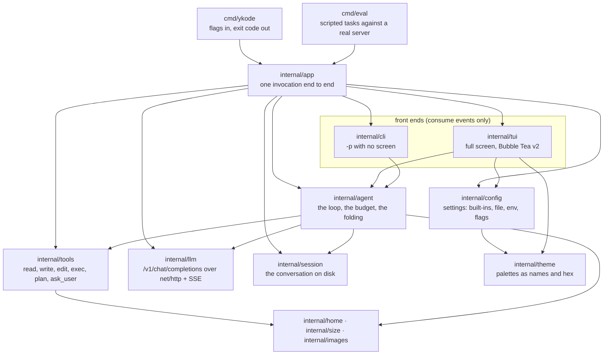

The dependency direction is one way. `app` is the only package that knows both front ends exist;
`tui` and `cli` only consume events the agent emits; `agent`, `tools`, `llm`, `session` and `config`
never import a front end; `theme` imports nothing of ykode.

| package | job |
|---|---|
| `cmd/ykode` | flags in, exit code out; nothing else |
| `cmd/eval` | scripted tasks against a real server, judged and counted |
| `internal/app` | settings → server → tools → agent → front end |
| `internal/config` | one table of knobs (`catalogue.go`) and the settings file |
| `internal/agent` | turns, budget, folding, permissions, commands, steering |
| `internal/tools` | the callable surface, each tool in its own file |
| `internal/llm` | request shapes, SSE stream, timings |
| `internal/session` | the conversation as an append-only log |
| `internal/tui` | the screen: transcript, overlays, input, status |
| `internal/cli` | the front end with no screen |
| `internal/images` | a picture shrunk and encoded for a vision encoder |
| `internal/theme` | palettes, so settings and screen read one list |

---

## 3. One invocation, start to finish

`app.Run` (`internal/app/run.go`) is the whole startup. Nothing is deferred or lazily wired: by the
time a front end starts, every budget has already been measured against the server.

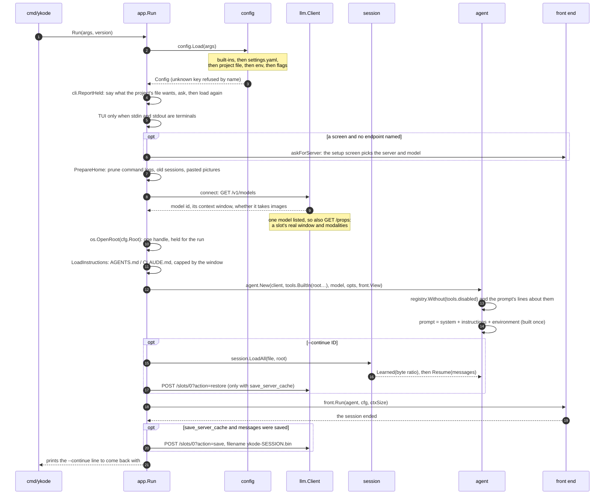

Notes on the parts that surprise people:

- **The server default is a guess, so it asks.** If no endpoint was named and a screen is available,
  `askForServer` opens the setup screen instead of failing with "cannot reach server" (`app/run.go`).
- **The window comes from the server, not from a flag.** `/models` gives the model's trained window;
  llama.cpp's `/props` gives one slot's actual share (`serverProps.fill`, `llm/types.go`), and the
  smaller wins. `--ctx`, when given, wins over both (`cmp.Or(cfg.CtxSize, model.CtxSize)` in
  `connect`) and pins the window across `/model` switches (`CtxPinned`).
- **The tool list is paid for once and reported**: `ykode: 6 tool specs, N bytes in every request`.
  A tool that is not offered is not paid for (`agent.Specs`, `agent.SpecBytes`).

---

## 4. What a request looks like

`agent.request()` (`agent/budget.go`) builds the one body shape the program ever sends:

| field | value | why it is there |
|---|---|---|
| `model` | current model id | `/model` and a server change move it, through `SetEndpoint` |
| `messages` | `a.history`, rewritten by `ChatRequest.MarshalJSON` | see below |
| `tools`, `tool_choice: "auto"` | `agent/specs.go`, fixed order | the list never changes mid-session |
| `max_tokens` | `replyRoom()` — the room the window has left, or the cap you asked for | `budget.go` |
| `reasoning_effort` | the level's word (`off` → `none`), or the nearest one this model takes | `agent/effort.go` |
| `reasoning_budget_tokens`, `thinking_budget_tokens` | `thinking_budget`, cut to fit the reply, under both names | `thinkingWithin` |
| `chat_template_kwargs` | `{"enable_thinking": false}` when thinking is off | Qwen3.6's template reads only this switch |
| `timings_per_token`, `return_progress` | always `true` | speeds and prefill progress while streaming; a constant so the shape never moves |
| `stream`, `stream_options` | `true`, `{"include_usage": true}` | set by `ChatStream`; the last chunk carries the prompt count |
| `temperature`, `top_p`, `top_k`, `min_p`, `presence_penalty` | the model's card (`config.SamplingFor`), flattened into the body | a field the card leaves unset is not sent |

`ChatRequest.Modalities` is **not** a wire field (`json:"-"`): it is `["image"]` when this model reads
pictures, and decides which attachments `MarshalJSON` writes. An attachment the model cannot take stays
out of the request and **in** the conversation.

`ChatRequest` has its own `MarshalJSON` (`llm/types.go`) because the conversation the program keeps
is not quite the conversation the API takes:

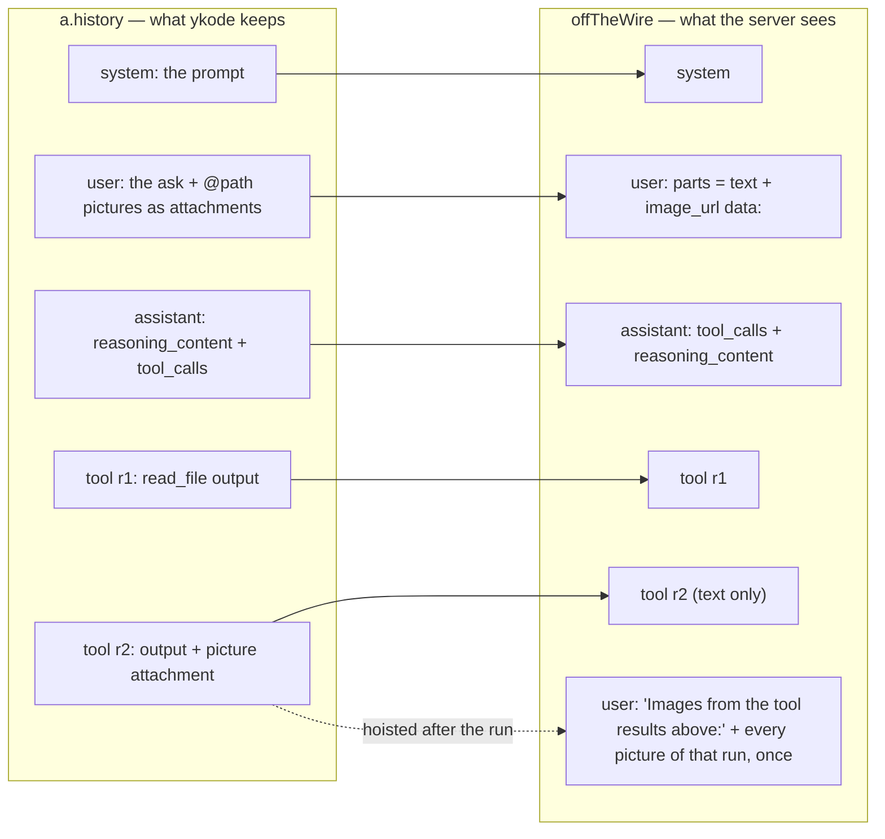

Three rules live in that one function:

1. **A picture read by a tool is sent once, after the run**, not inside each tool reply — the API has
   no room for image parts in a `role:"tool"` message (`imagesNote`).
2. **An attachment this model cannot take is left out of the request, not deleted from the
   conversation** — switch to a vision model mid-session and the pictures it was never sent arrive.
3. **ykode's own result ids (`r1`, `r2`) are internal**: they number tool replies for the summaries
   and the log, and never go on the wire.

---

## 5. The turn loop

This is the heart. `agent.ask` (`agent/turn.go`) runs round-trips until the model answers in text.

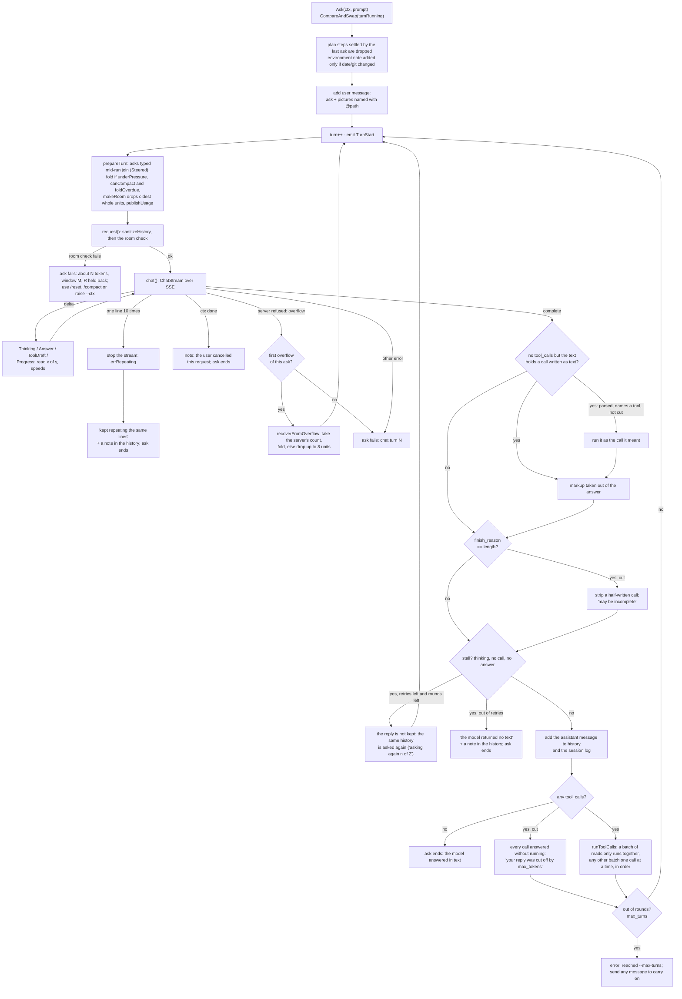

Reading the loop in words:

1. **One ask owns the conversation.** `Ask` takes `turnRunning`, and a second `Ask` is refused;
   `SetModel`, `Tune`, `SetEndpoint`, `Reset` and `SetThinkingLevel` refuse through
   `refuseDuringATurn` while it is held. `Compact` does not refuse: it takes `turnRunning` when it is
   free and otherwise runs as part of the turn that holds it, which is how `prepareTurn` and the
   overflow recovery call it. `/compact` typed mid-run is held by the command gate instead (§10).
2. **Between round-trips, three things may rearrange the conversation** — your typed asks join it
   (`Steered`), a fold replaces older turns with a summary, and `makeRoom` drops the oldest whole
   units. Never *during* one.
3. **A reply with no tool call ends the ask.** There is no "keep going" prompt: a nudge costs a whole
   round of thinking, so instead a reply that ends after its thinking is **dropped and the identical
   request is sent again** — keeping such a turn teaches the model that a round may end there. Two
   retries per stall (`thinkingRetries`), never past `max_turns`, and any kept reply resets the count.
   A retry is a new round, so `prepareTurn` runs first and a steered ask can join it.
4. **Everything a tool returns becomes text the model can act on.** `runTool` never returns an error:
   a refusal, an unknown tool, bad arguments and a cancelled call all come back as
   `error: …` in the tool reply.

### What can end a turn early

| situation | detected in | what happens | kept in history? |
|---|---|---|---|
| server cancelled mid-stream | `llm.streamAccumulator.turn` → `Unfinished` | one notice per run: it may be cut short | yes, what arrived |
| reply repeating itself | `stuckreply.go`: one line ≥ 10 times (`stuckLineMin` 24 chars) | stream cancelled, ask ends with a note | the note only |
| reply stopped at `max_tokens` | `finish_reason == "length"` | half-written calls stripped; those calls fail without running | yes |
| reply with thinking but no call and no answer | `stoppedAfterThinking` | not kept; same request re-sent, ≤ 2 times | the note only |
| the estimate leaves under 64 tokens for a reply | `request()`, before anything is sent | the ask fails, naming the reserve: `/reset`, `/compact` or a bigger `--ctx` | yes |
| the server refused the request for room | `llm.IsOverflow`, `StatedPromptTokens` | fold, else drop up to 8 units, then a new round; a second refusal in the same ask fails it | yes |
| user pressed esc / ctrl+c | `ctx.Err()` | request cancelled; a `neverRan` reply is written for every unanswered call | yes |
| `max_turns` reached | `rounds.go` | the ask ends with an error you can answer to continue | yes |

---

## 6. Context arithmetic

Every budget in ykode is a distance from one number: the server's context window. The marks are
computed in `agent/budget.go`, `agent/compact.go` and `agent/history.go`. `/ctx` shows the window, the
estimate and the result cap; the marks themselves are internal and appear only in the notices they cause.

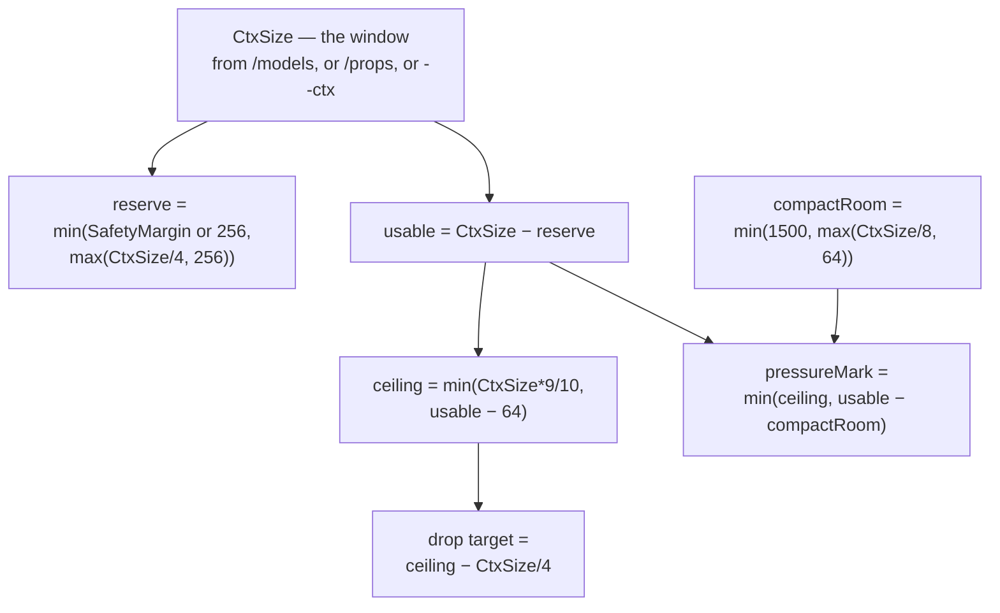

Worked example at a 32 768-token window and the default `safety_margin: 4096`:

| mark | value | meaning |
|---|---|---|
| `reserve` | 4 096 | never sent: room for the reply and the template |
| `usable` | 28 672 | what a request may fill, reply included |
| `ceiling` | 28 608 | above it, the oldest messages start going |
| `pressureMark` | 27 172 | above it, a fold is worth paying for |
| `drop target` | 20 416 | one drop frees a quarter of the window, so it aims below the ceiling by that |
| reply cap | 28 672 − estimated | `max_tokens` for the next request |
| result cap | `ResultBytesFor(32768)` = 13 104 bytes | about a tenth of the window, clamped between 1 200 and 12 800 tokens |

**How "estimated" is computed.** `estimateTokens` (`agent/history.go`) never re-counts from scratch.
The server's last real prompt count is an anchor; anything that moved since is divided by the byte
ratio that count implied (`meter.bytesPerTok`, floor `minBytesPerTok` 1.5). An attachment counts as
`attachmentBytes` 4 000 bytes, not the length of its base64. This is why `/ctx` can be exact-ish while
a full re-count of a 30 000-token conversation would cost CPU on every tool call.

**One arithmetic for every cap.** Tools never invent their own cut: `tools/result.go` owns
`resultCap` (cap minus 512 bytes of note room, floor 64) and `ResultBytesFor(window)`. `app.Options`
hands the same number to both the tools and the agent, so a result and the agent's view of it agree.

---

## 7. Folding: the summary the model writes

Folding is the expensive rescue, so it is deliberately rare and deliberately cache-friendly.

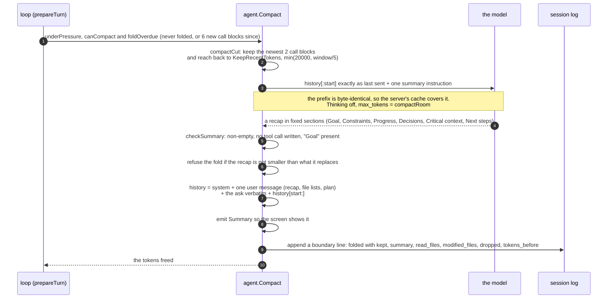

Details that matter:

- **The summary is asked for at most twice**: first as a normal request (`tool_choice: auto`, which
  matches the cached prefix), then, if the first reply was a tool call or failed `checkSummary`, with
  `tool_choice: none` (`compact.go: summarise`). A prefix that would not fit the window is not sent at all.
- **What survives a fold**: the recap, the list of files the folded turns read and changed
  (`noteFiles`, `fileBlocks`, up to `maxListedFiles` 60), the plan as the model last wrote it, and
  the current ask word for word — a summary describes what happened, not what was asked.
- **Thinking is not kept** across a fold, which is why the instruction tells the model to write down
  the *conclusion* its thinking reached.
- **A fold that saves nothing is refused** — comparing the recap against `historyBytes(dropped)` stops
  ykode paying a request to make the conversation the same size.
- **Dropping is the last resort** (`makeRoom`): whole units (an assistant call plus its tool replies)
  go oldest-first, never the recap, never a lone tool reply, never the current ask; each drop writes
  one `removed {from,to}` line rather than a copy of the conversation, and the notice names up to
  three of what went (`namedDrops`) because "which call is missing" decides whether the model redoes
  it or guesses.

---

## 8. Tools

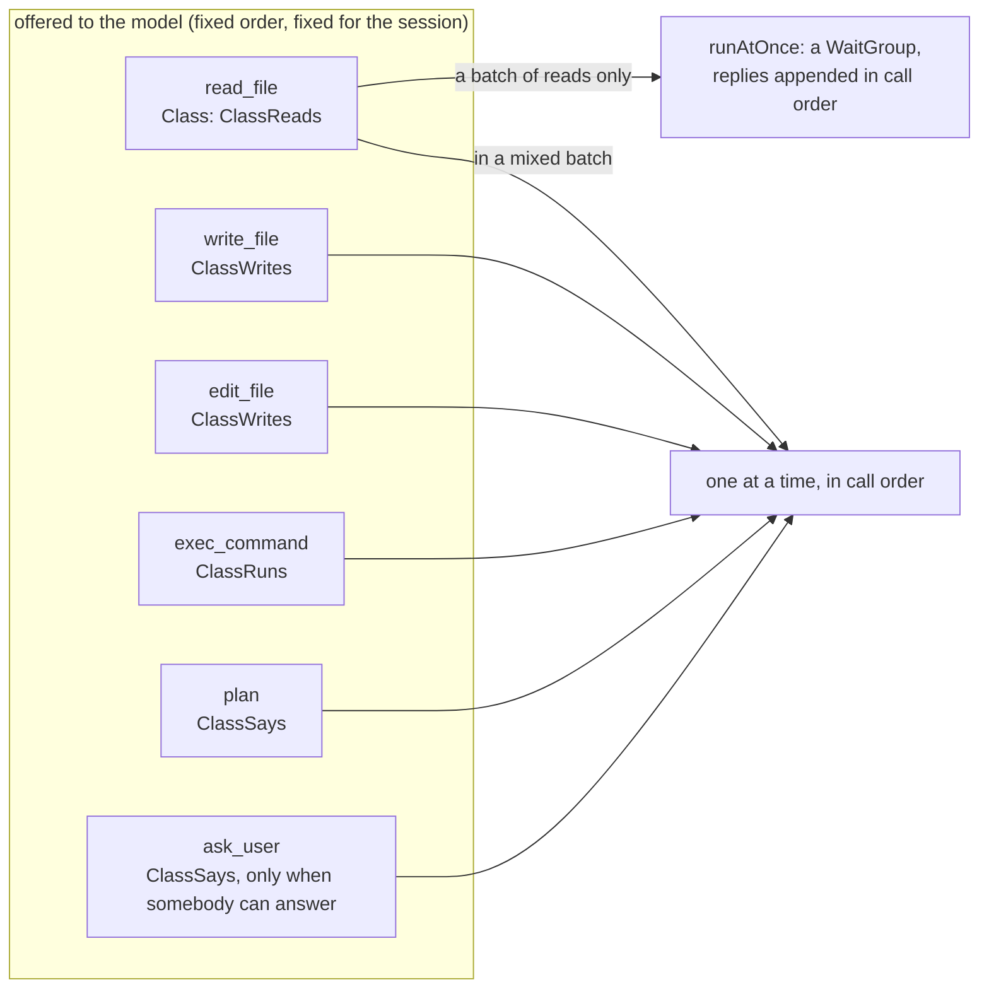

A tool's class is its contract (`tools/class.go`, decided once in `agent/class.go`): reads may
overlap, writes and runs never do, and **an unknown name reads as `ClassRuns`** — a hallucinated
tool cannot sneak into a parallel batch. A batch runs together only when every call in it is a read
(`allReadOnly`); one write or command in it makes the whole batch serial.

| tool | what it does | bounds |
|---|---|---|
| `read_file` | text from a line offset; a png/jpeg/gif/webp becomes an attachment instead | `tools.read_lines` 2000, byte budget from the window |
| `write_file` | replaces a whole file, making parent directories | result budget |
| `edit_file` | exact replacement of `old_text`, which must occur once | a wrong guess fails loudly |
| `exec_command` | one `sh -c` in the root | 60 s default, 10 min max; output through a window, the whole log under `$YKODE_HOME/logs` |
| `plan` | the model's checklist, shown beside the prompt | one shared list, read while it is written |
| `ask_user` | one question with choices, answered in the box | offered only when the sink implements `Asker` |

Two boundaries, on purpose different from each other:

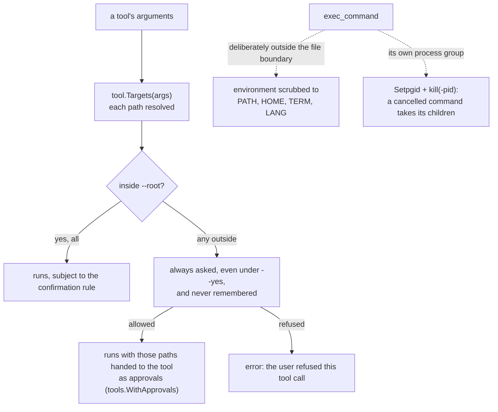

- **Files**: one `*os.Root` (`tools/paths.go`). A model that copies the root from its own environment
  and drops the leading slash is repaired (`rootWithoutSlash`); anything else outside is reported to
  the agent as a `Target{Outside: true}` and asked about.
- **Commands**: not confined. They run with your permissions, so their *environment* is reduced to
  four variables to keep secrets out of a model-run command, and they get their own process group so
  a timeout or an esc kills the whole tree (`exec.go: Setpgid`, `kill(-pid)`).
- **A cut output is not lost**: `newOutWindow` keeps the head and tail the model sees and writes the
  whole thing to a spill directory whose path is named in the result.

### The confirmation decision

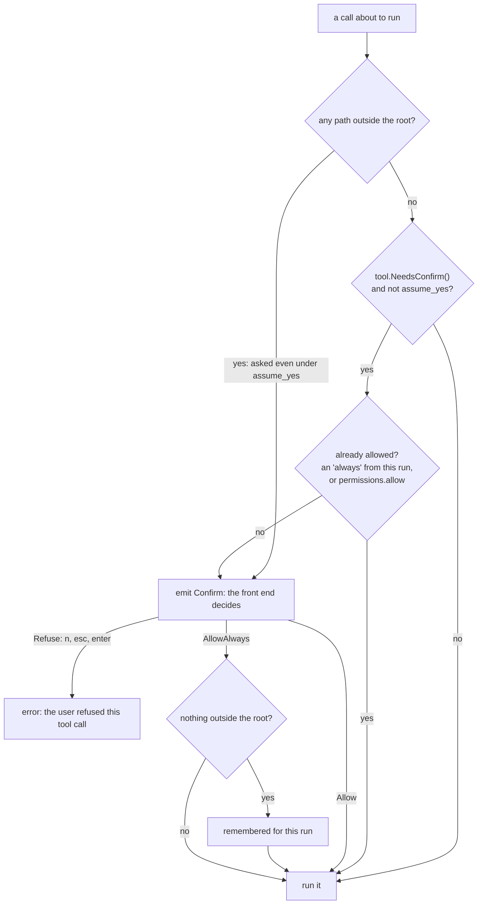

`permissions.allow` entries name a tool (`exec_command`) or a narrower prefix (`exec:go test`, or one
file). They come from settings and from an `always` verdict in the run; a path outside the root is
never remembered, because remembering it would make the next outside write free.

---

## 9. A call written as text, and other malformed replies

Small local models write tool calls into their answer instead of making them. ykode runs the ones
that parse, and never shows the markup:

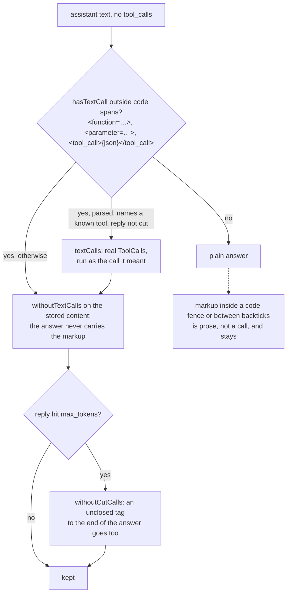

Two repairs keep a malformed reply from breaking the next request. `repair` (`repair.go`) patches a
reply as it arrives: a missing role or call id, and arguments sent as an object instead of a string.
`sanitizeHistory` (`budget.go`) runs before every request: it replaces invalid JSON in a stored call's
arguments with `{}` and adds a `neverRan` tool reply for every call that has none — a missing reply
fails the whole request on most servers.

---

## 10. Steering: typing into a run that is running

Nothing interrupts a round-trip. Asks typed mid-run queue, and are appended between round-trips,
which is why the loop calls `prepareTurn` first:

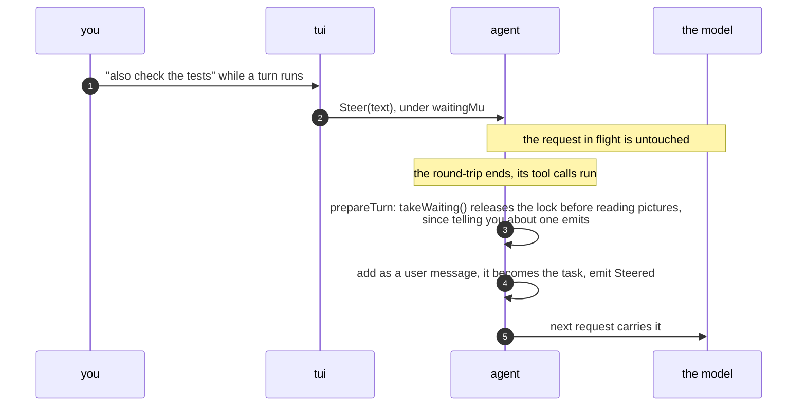

Commands have one waiting rule and one owner for it: the `Waits` column of `agent.Commands()`,
enforced by one gate in `tui/run.go` (`agent.CommandIsSafeDuringATurn`). A command that would change
what the request in flight is built from — `/compact`, `/reset`, `/model`, `/think`, `/sessions`,
`/create-local-setting` — is held with the words *"that waits for the turn to finish: press esc to
stop this one first"*. `/exit` mid-run cancels instead of racing. Never add a per-handler "is a turn
running" check.

Ownership as a state machine:

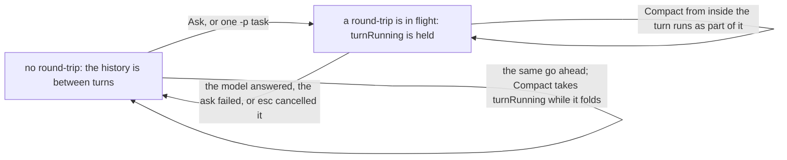

---

## 11. The conversation on disk

`internal/session` keeps an append-only log. A change to the conversation is a line *naming a
position*, never a rewrite of the file — so a resume can reproduce exactly what the last run sent.

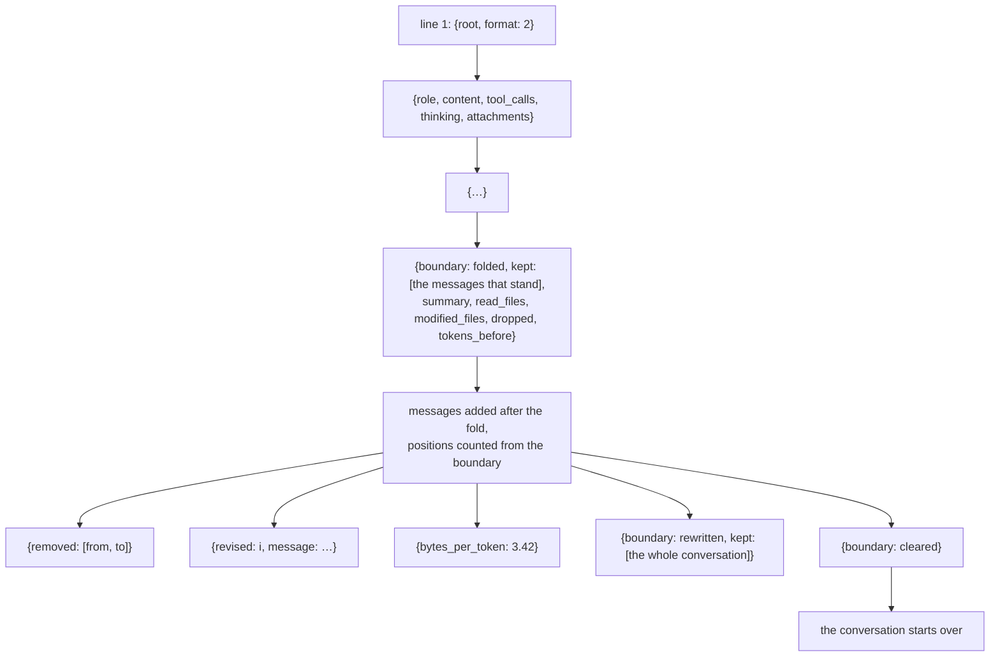

| line | written when | what a reader does with it |
|---|---|---|
| `header {root, format}` | at creation | refuses to resume into another project; refuses a newer `format` rather than misreading one |
| message record | every `add` | replayed in order; thinking is stored once, under `thinking` |
| `boundary: folded` | a fold replaced older turns | its `kept` list is the conversation from here; earlier lines no longer count |
| `boundary: rewritten` | messages moved: `sanitizeHistory` added replies, or a drop or repair the log was out of step for | the whole current conversation is stored again so positions still line up |
| `boundary: cleared` | `/reset` | the saved conversation starts over, so `--continue` cannot hand back what you deleted |
| `removed [from,to)` | one dropped unit | cheap: one line per drop instead of a full rewrite |
| `revised {i, message}` | a call's arguments were repaired | the message at that position is replaced |
| `bytes_per_token` | the server counted a prompt | the next run measures its conversation the same way (`Learned`) |

Leaving prints the pasteable way back, with `--root` spelled out because a saved conversation is only
read back by the project it was written in:

```
ykode: 41 messages saved in ~/.ykode/sessions/s20261121-101530.112.jsonl
ykode: come back with: ykode --continue s20261121-101530.112 --root ~/Developer/ykode
```

---

## 12. Settings: one table, five sources

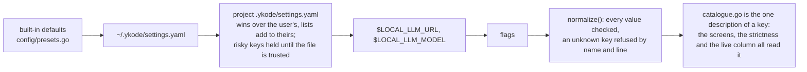

A new setting is one row in `config/catalogue.go` — its `key`, `label`, `group`, `unit`, `kind`,
`options`, `items` and whether it is **live** (taken up at once) or waits for the next start. The
`/settings` screen, the loader's strictness and the "restart to apply" column all read that table, so
there is never a second list to drift. A project's file is only trusted as far as the run is told:
until you accept it, `stripUnsafe` (`config/settings.go`) holds back what could redirect or loosen the
run — `base_url`, `model`, `assume_yes`, `keep_sessions`, `permissions.allow` and the command-log
keys — and `cli.ReportHeld` says what it wanted and asks. Trust is the file's hash, so any edit to it
is asked about again (`config/trust.go`).

---

## 13. The two front ends

Both front ends are event consumers. `agent.Sink` is the whole interface between them, and a
confirmation is an event that answers:

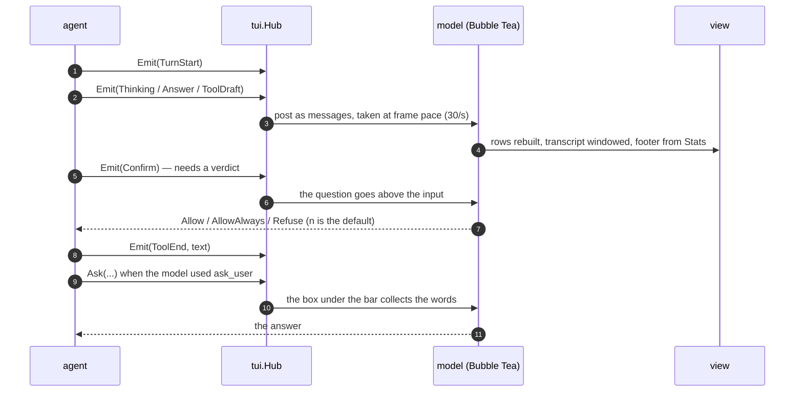

- **`tui`**: Bubble Tea v2. Streaming writes rows and a frame is due at most every 33 ms
  (`frameInterval`), so a fast server cannot make the screen flicker. The input box grows to
  `maxInputLines` 10 visible rows and holds `maxInputRows` in total, so a pasted file still fits.
- **Modes**: the screen never takes the pointer, and always writes the pointer-off sequences plus
  `ResetModifyOtherKeys`/`PopKittyKeyboard` before drawing and on every way out — including the setup
  screen run on its own (`tui.go: writeModesOff`).
- **Styles**: package variables read by every drawing, so a theme switch happens only inside `Update`
  (`tui/palette.go: usePalette`) and bumps `paletteGen` so kept rows are drawn again.
- **`cli`** (`-p TASK`): one task, answer on stdout, log on stderr, a write that did not land fails
  the run; `cli.IsTerminal` decides whether a screen is even possible.

---

## 14. Models, thinking, sampling

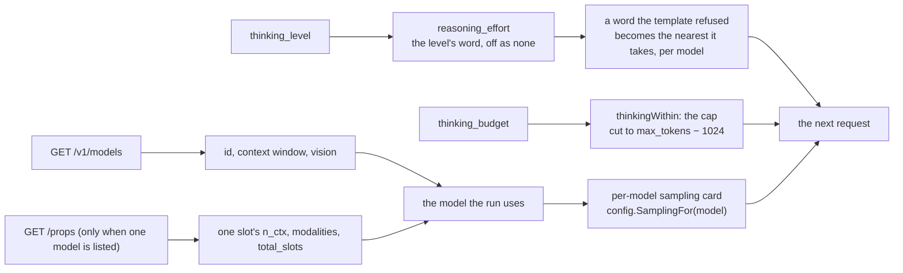

Depth and length are separate (`agent/budget.go`, `agent/effort.go`, `llm/thinking.go`):

| setting | on the wire |
|---|---|
| `thinking_level` | `reasoning_effort`: `off` → `none` plus `enable_thinking: false`; every other level its own word |
| `thinking_budget` | `reasoning_budget_tokens` (strata, llama.cpp) and `thinking_budget_tokens` (radiance), same value |

The templates disagree on the words: Inkling 2 Mini takes all seven, Qwen3.8 27B and Flash-Next take
`low`/`medium`/`xhigh` (radiance also maps `high`), Qwen3.6 35B A3B has no ladder and reads only
`enable_thinking`. A refusal that mentions `reasoning_effort` (`llm.RejectedEffort`) rules that word out
for the model and the same request goes again with `llm.NearestEffort`: from the server's
`error.supported` list when it gives one, otherwise along the ladder, deeper first on a tie, never down
to `none`. Each refusal removes one word, so the walk ends, at worst with the field left out. The fold
sends the turns' word too, because a template may render it into the prompt the cache matches on.

The cut matters in practice: thinking is billed inside `max_tokens`, so a long thought in a small
window would otherwise leave the answer no room at all — and a budget of literally 0 would be omitted
on the wire, where omission means *no limit*. With no `thinking_budget` set the cap is that room
itself. `ThinkingBudget()` exposes the post-cut number, which `/settings` shows under the cap.

`/model` and a server change are between-turn operations. A switch moves the model id, the window
(unless `--ctx` pinned it), the vision flag, `KeepRecentTokens`, and the sampling card if that model
has one — the system prompt and the tool list do not move, so the cache still matches up to the point
where the model differs.

---

## 15. Pictures

A vision model can be shown an image three ways, and all three end up as `Attachment` on a message:

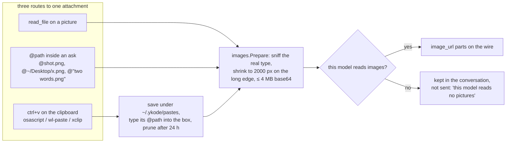

`@path` is deliberately the one place a *user*-named path may leave `--root` (`agent/pictures.go`,
recorded as an invariant in `AGENTS.md`): the path came from the person, not the model. An ask's
picture is stored in the session log as base64, bounded by `images.maxEncoded` (4 MB) per picture.

---

## 16. The server's cache across runs

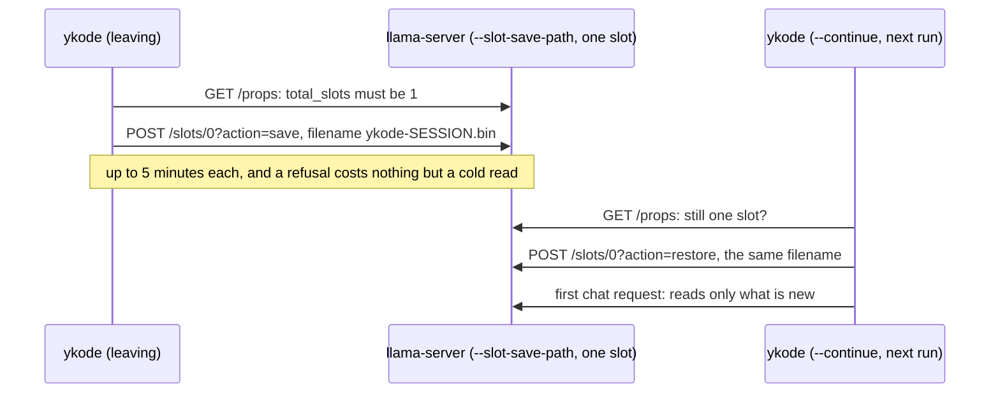

This is the `save_server_cache` setting. The constraints are the server's, not ykode's: one slot
(otherwise there is no way to know which holds this conversation) and `--slot-save-path`. A long
conversation's file is gigabytes, which is why each call may take up to `slotWait`, 5 minutes. Both
happen outside the screen, on stderr: the restore right after the resume, the save after the screen
closes, and only when the run saved any messages.

---

## 17. The eval harness

`cmd/eval` is a second `main` that builds an agent exactly the way `app.Options` does, so a measurement
is a measurement of what a run does.

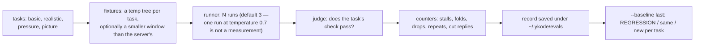

By default it runs against an **empty `$YKODE_HOME`**, so your settings, your themes and your
`AGENTS.md` change nothing it measures (`--use-settings` opts back in). `make eval ARGS="--thinking
xhigh --baseline last"` measures one thinking level against the last run.

---

## 18. Invariants that break quietly

| invariant | where | what breaks if it moves |
|---|---|---|
| The system prompt never changes mid-session | `agent/prompt.go`, `agent/environment.go` | every token after the change is re-prefilled |
| The tool list never changes mid-session | `agent/specs.go`, `agent.New` (`Without`) | same: a tool added or dropped mid-run costs the cache from there |
| Date and git state travel on the newest ask | `agent/environment.go` | a prompt edit per ask, and a cache miss per ask |
| The log is append-only, positions refer to the log as it stands | `session/session.go`, `agent/history.go` | a resume sends different bytes than the last run sent |
| One goroutine owns the conversation | `agent/agent.go`: `turnRunning`, `refuseDuringATurn` | two writers, a torn history, a request built mid-change |
| One owner for the "which commands wait" rule | `agent/commands.go` table, gate in `tui/run.go` | a command that rewrites the history while a request reads it |
| A key is described once | `config/catalogue.go` | a settings file the next start refuses to read |
| Result caps share one arithmetic | `tools/result.go` | a tool that cuts differently from what the agent budgets |
| A tool's class is its contract | `tools/class.go`, `agent/class.go` | a stateful read tool races with itself |
| File access is one `*os.Root` | `tools/paths.go` | a path that walks out, a symlink that lands outside |
| The screen never takes the pointer, and pops the keyboard protocols | `tui/tui.go: writeModesOff` | the next program in that terminal misreads keys |
| Styles are rebuilt only on the screen's goroutine | `tui/palette.go: usePalette` | a torn palette: half the frame in each theme |

---

## 19. Numbers worth knowing

| constant | value | file |
|---|---|---|
| `thinkingRetries` | 2 per stall | `agent/turn.go` |
| `overflowDrops` | 8 units | `agent/turn.go` |
| `ctxSafetyTok` / `minResponseTok` / `minAnswerTok` | 256 / 64 / 1024 | `agent/budget.go` |
| ceiling mark | `min(window*9/10, usable−64)` | `agent/budget.go` |
| `dropShare` | frees a quarter of the window | `agent/history.go` |
| `attachmentBytes` | 4000 per attachment | `agent/history.go` |
| `minBytesPerTok` | 1.5 | `agent/usage.go` |
| `compactKeep` / `foldGap` | 2 call blocks kept / 6 new before folding | `agent/compact.go` |
| `compactMaxTokens` / `maxSummaryChars` | 1500 / 6000 | `agent/compact.go` |
| `KeepRecentTokens` | `min(20000, window/5)` | `agent/options.go` |
| `stuckLineMin` / `stuckLineLimit` | 24 chars seen 10× | `agent/stuckreply.go` |
| `defaultResultBytes` / `budgetSlack` / `maxResultTokens` | 12000 / 512 / 12800 | `tools/result.go` |
| `maxExecTimeout` | 10 min (default 60 s) | `tools/exec.go` |
| `defaultReadLines` / `defaultExecTimeout` / `defaultMaxTurns` / `defaultSafety` | 2000 / 60 s / 100 / 4096 | `config/config.go` |
| `maxAskedPictureBytes` | 12 MB in | `agent/pictures.go` |
| `maxSide` / `maxEncoded` | 2000 px / 4 MB base64 | `images/prepare.go` |
| `frameInterval` | 33 ms | `tui/model.go` |
| `clipWait` / `pasteKeep` | 3 s / 24 h | `tui/clipboard.go`, `app/home.go` |
| `slotWait` | 5 min | `app/servercache.go` |
| session `format` | 2 | `session/session.go` |
| eval `--repeat` default | 3 | `cmd/eval/main.go` |

---

## 20. What each file in `internal/agent` owns

| file | the one thing it holds |
|---|---|
| `agent.go` | the Agent: state, `New`, `Reset`, turn ownership, `add` |
| `turn.go` | the loop: `Ask`, `ask`, `prepareTurn`, `chat`, stall and cut handling |
| `budget.go` | the request body, the window arithmetic, `sanitizeHistory` |
| `history.go` | the token estimate, dropping whole units, byte bookkeeping |
| `compact.go` | folding: the cut, the summary request, the recap and its checks |
| `execute.go` | one tool call: arguments, targets, permission, result formatting |
| `parallel.go` | a batch of calls: read-only together, replies in call order |
| `class.go` | name → class → whether it may overlap or changed the project |
| `permissions.go` | what the user already agreed to keep allowing |
| `textcalls.go` | a call written as text: match, parse, strip |
| `repair.go` | a malformed call made sendable |
| `stuckreply.go` | a reply stuck repeating itself |
| `steer.go` | the queue of asks typed into a running turn |
| `pictures.go` | `@path` in an ask, and the picture it reads |
| `prompt.go` | the system prompt, instruction files, dropping lines about disabled tools |
| `environment.go` | the `<environment>` block on the newest ask |
| `specs.go` | the tool list and what it costs every request |
| `commands.go` | the slash-command table, `/help`, `/usage` text |
| `events.go` | `Event`, `EventKind`, `Sink`, `Asker`, `Decision` |
| `models.go`, `sessions.go` | `/model`, `/sessions` |
| `usage.go` | `Usage`, the byte ratio, the meter |
| `contextwork.go`, `pace.go` | what this ask did to fit, and the measured decode speed |
| `options.go` | `Options`, `KeepRecentTokens`, the between-turn setters |
| `ask.go`, `rounds.go` | how `ask_user` reaches the person; the `max_turns` round count |
| `describe.go`, `files.go` | a call described in one line; the file lists a fold keeps |

---

## 21. How to extend it

| change | one place |
|---|---|
| New tool | a file in `internal/tools` implementing `Tool` and `Class()`, added in `tools.BuiltIn`; the class decision stays in `agent/class.go` |
| New slash command | one row in `agent/commands.go` (name, args, note, `Waits`), handled in `tui/run.go` if it needs a screen; a test proves the table and the gate agree |
| New setting | one knob in `config/catalogue.go`, its default in `config/presets.go`, the live column decided there — the screens need no edit |
| New theme | one `Palette` in `internal/theme/theme.go`; the setting's choices, the screen and the tests all read that list |
| New wire field | `internal/llm/types.go`, plus a test that it is only sent when it has to be: a shape change moves every later token |

Keep the invariants (§18) and the loop stays honest: **the prompt cache is the design, the append-only
log is the memory, and one goroutine is the author.**
